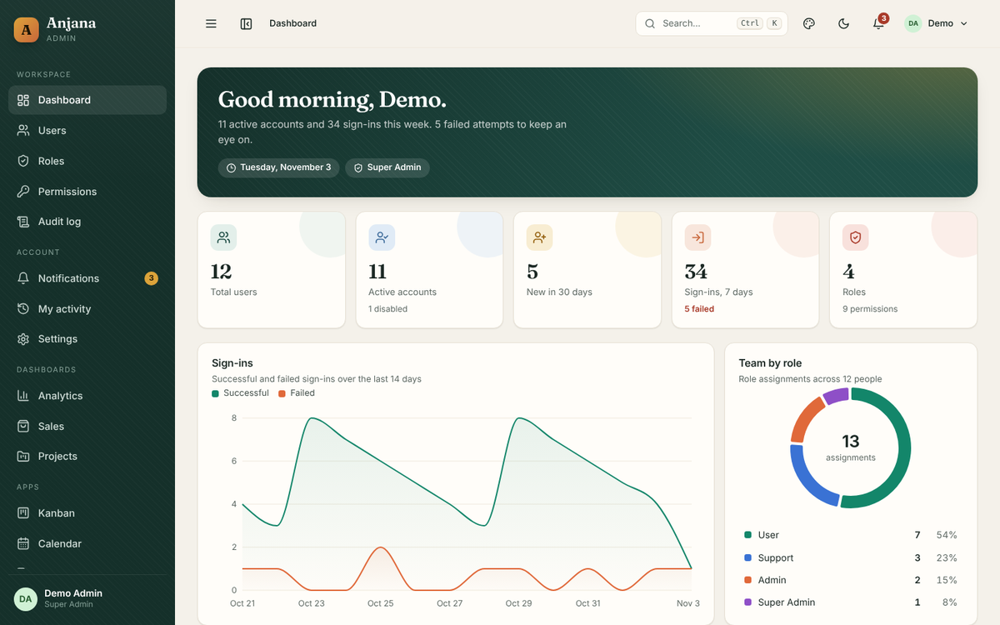
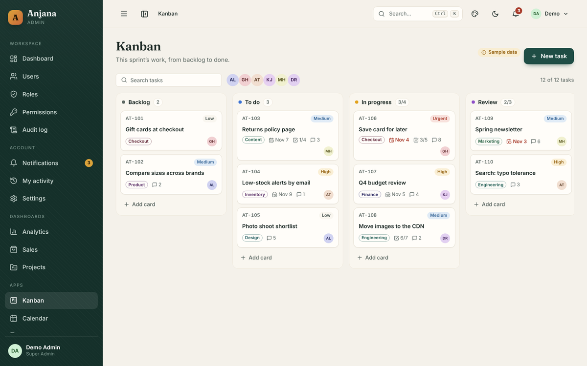
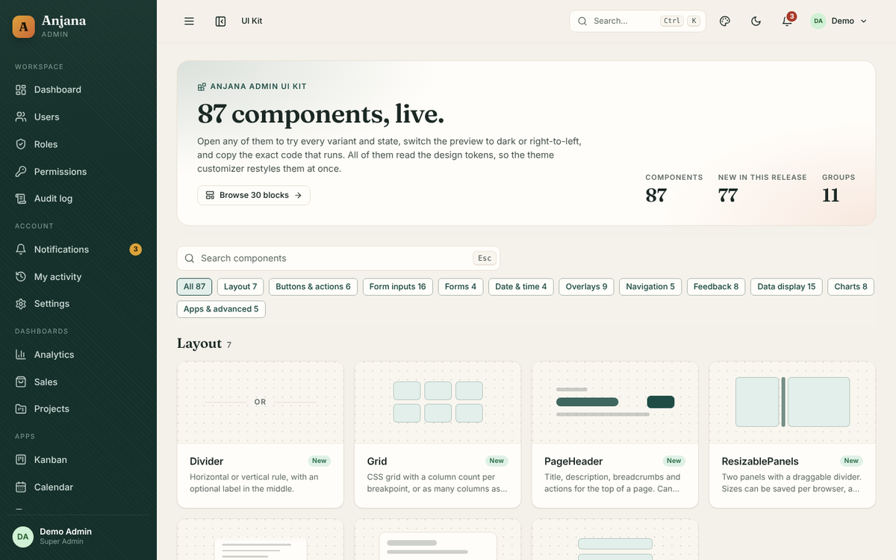
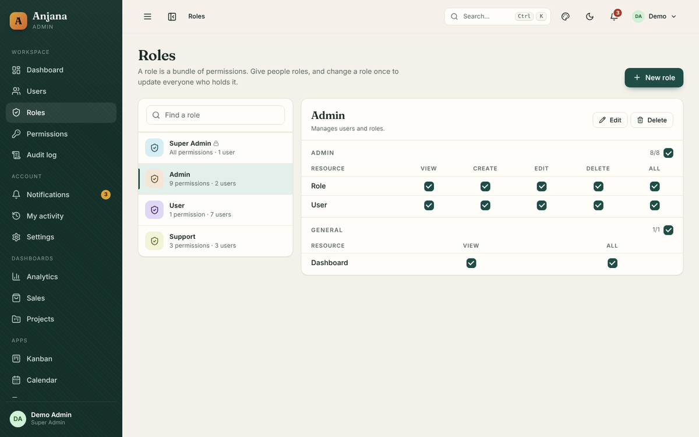
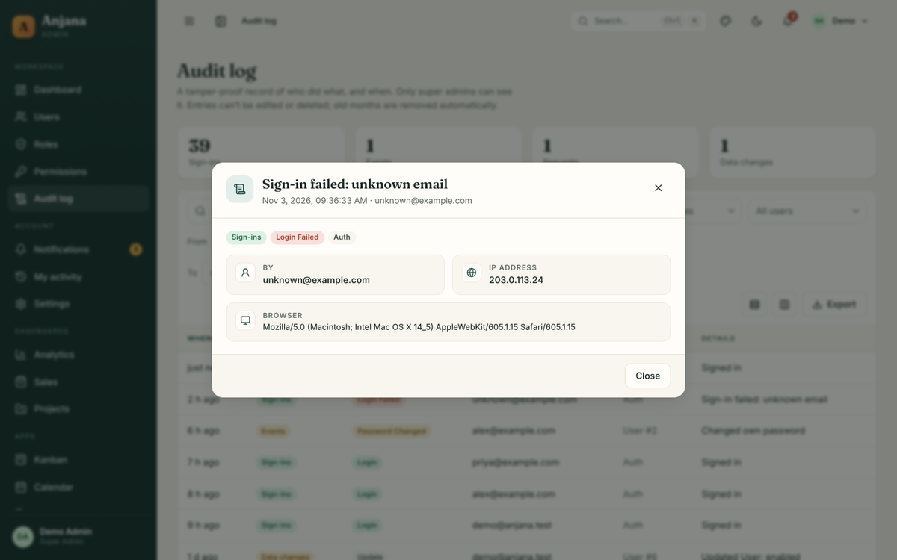

# Anjana Admin

A full-stack admin application I designed and built: sign in, users, roles, permissions, a dashboard and an audit log,
with an 87-component UI kit and six app pages on top. Built by **Anjana Ariyasinghe** for startup companies that need
a secure, ready-made admin and back office, so they can launch on a proven foundation instead of building one from scratch.



**Try it without installing anything:** open `anjana-admin-demo.html` (built with `npm run build:standalone`) in a
browser, or run `npm install && npm run demo`, and click **Sign in**. It runs entirely on sample data.

**Highlights**

- Real role-based access control: menus, pages and individual buttons follow the signed-in user's permissions, and the Spring Boot API enforces the same rules
- An audit log of every sign-in and data change, with before/after values, IP and browser
- Two-step sign-in (TOTP) with recovery codes, revocable sessions, email confirmation and a lock screen
- 87 accessible components with live docs and playgrounds; every docs page is tested with axe
- WCAG 2.2 AA contrast in light and dark mode, right-to-left support, first screen under 150 kB gzipped
- 200 front-end tests (Vitest + Testing Library + axe) and 21 API integration tests

| | |
| --- | --- |
|  |  |
|  |  |

## About the app

React 19 + TypeScript + Vite. Original design with an 87-component UI kit, a charts kit, 30 ready-made blocks, six app pages (Kanban, Calendar, Chat, Mail, Files, Invoices), a live theme customizer (6 presets, light/dark, right-to-left), a motion system, and fully responsive layouts.
Pairs with the **Anjana Admin API** (Spring Boot back end).

## What's included

| Screen | What it does |
|---|---|
| **Sign in** | Email + password, clear errors (wrong password, locked out, disabled, email not confirmed), two-step sign-in with an authenticator code or a recovery code, automatic sign-out when a session ends |
| **Sign up and email links** | Register (can be turned off in the API), confirm email, forgot / reset password with one-time links that expire, resend with a cooldown |
| **Lock screen** | Locks after a chosen idle time or from the user menu; the session stays, the password unlocks it |
| **Dashboards** | Overview of users, sign-ins and roles; plus sample **Analytics**, **Sales** and **Projects** dashboards with a date-range filter, KPIs, charts and tables |
| **Dashboard (overview)** | Users, active accounts, new users, sign-ins and failures, roles; 14-day sign-in chart; team by role; newest members; recent activity |
| **Users** | Searchable, sortable table with role and status filters; add / edit in a modal; profile view with effective permissions; enable, disable and delete one or many; CSV export |
| **Roles** | Role list with user counts; permission grid grouped by module with select-all per row and module; built-in super admin role locked |
| **Permissions** | Catalogue of every permission with description and the roles that hold it; unassigned filter; CSV export |
| **Audit log** *(super admins)* | Every sign-in, change request and data change, with before/after values, IP, browser, and links between rows from the same request; date and type filters; CSV export |
| **UI Kit** | A live gallery of all 87 components (`/ui`), a **Blocks** gallery (`/ui/blocks`) of 30 copy-ready sections, and a **Motion** gallery (`/ui/motion`) of all 16 animations: search and group filters, a playground with live controls, examples you can switch to dark, right-to-left or phone width, copyable code, keyboard and accessibility notes, props |
| **Theme customizer** | Drawer from the top bar: 6 colour presets or your own brand colour, light / dark / system, left-to-right or right-to-left, density, corner radius, font pair, sidebar style, content width, reduce motion. Saved per browser; **Copy CSS** exports your theme as tokens |
| **System pages** | 404, 403, 500, maintenance (with countdown) and coming soon (with sign-up), plus a crash screen that catches page errors |
| **Settings** | Profile; security (password, two-step sign-in with QR setup and recovery codes, signed-in devices you can sign out, lock-screen timer); notification preferences per category for in-app and email; appearance |
| **Notifications** | Bell with unread count in the top bar, and a full page with filters, mark read / unread and delete |
| **My activity** | Your own sign-ins, security changes and edits, grouped by day |
| **Command palette** | ⌘K / Ctrl+K (or /) to jump to any page, action or person |
| **Access control** | Menu items, pages and buttons appear only when the user holds the permission; permissions refresh when the tab regains focus |
| **Apps** | Kanban board (drag and drop, keyboard moves, WIP limits), Calendar (month and week, drag to reschedule), Chat (mentions, typing, read ticks), Mail (folders, bulk actions, rich-text compose), Files (tree, grid and list, upload, image viewer) and Invoices (list, detail, print / PDF), all on sample data |
| **Content pages** | Pricing, Help centre with search, Changelog, and a starter page to copy for new features |
| **Docs site** | `docs/`: a VitePress site with guides, the component and block lists, and the API reference (`npm run docs:dev`) |
| **Demo mode** | Runs on built-in sample data with no back end, for showcasing |

## Reusable components

### SearchSelect — `src/components/search-select`

A searchable dropdown used for every choice in the app. See it live at `/ui/search-select`.

- Filters as you type across label, description and hidden keywords; ignores case and accents; best matches first; matches highlighted
- Single or multi-select (chips, “+N”, Select all / Clear, optional maximum)
- Groups, icons, avatars or flags, description lines, disabled options
- Server search (`loadOptions`, debounced, out-of-date answers ignored) and “Create …” for new options
- Clearable, two sizes, disabled and error states, hidden inputs for plain forms
- Opens above when there is no room below, follows the field on scroll, works inside modals
- 10,000-option lists stay smooth (virtual scrolling)
- Full keyboard support and ARIA combobox semantics; tested with axe

```tsx
<SearchSelect aria-label="Country" options={countries} value={country} onChange={setCountry} clearable />
<SearchSelect aria-label="Roles" multiple options={roles} value={roleIds} onChange={setRoleIds} />
<SearchSelect aria-label="Assign to" value={userId} onChange={setUserId} loadOptions={(q) => searchUsers(q)} />
```

### DataTable — `src/components/data-table`

One component powers every list in the app. Give it rows and column definitions and it handles the rest:

- **Global search** across any columns you mark as searchable
- **Sorting** – click a header for ascending, descending, off; numbers, text and dates sort correctly, blanks last
- **Pagination** with page numbers and a rows-per-page picker
- **Column visibility** menu, with columns that can start hidden
- **Row selection** – per row, whole page or every matching row – with a **bulk-action bar**
- **CSV export** of the visible columns (all filtered rows, or just the selection); opens cleanly in Excel
- **Density toggle** – comfortable or compact rows
- **Remembers** each table's page size, density and hidden columns in the browser
- **Clickable rows** (mouse or Enter key), per-row action buttons
- **Loading skeletons**, separate "nothing yet" and "no matches" empty states, and an error state
- Accessible: `aria-sort` on headers, labelled checkboxes, keyboard-reachable rows; scrolls sideways on small screens

```tsx
import { DataTable, type Column } from '../components/data-table';

const columns: Column<Product>[] = [
  { id: 'name',  header: 'Name',  hideable: false,
    cell: (p) => p.name, sortValue: (p) => p.name, searchValue: (p) => p.name },
  { id: 'price', header: 'Price', align: 'right',
    cell: (p) => `$${p.price.toFixed(2)}`, sortValue: (p) => p.price, exportValue: (p) => p.price },
  { id: 'sku',   header: 'SKU',   defaultHidden: true,
    cell: (p) => p.sku, searchValue: (p) => p.sku },
];

<DataTable
  id="products"                      // key for remembered preferences
  data={products} columns={columns} rowKey={(p) => p.id}
  loading={isLoading} error={errorText}
  initialSort={{ id: 'name', dir: 'asc' }}
  toolbar={<select>…</select>}       // your own filters
  selectable bulkActions={(rows, clear) => <button onClick={…}>Archive {rows.length}</button>}
  rowActions={(p) => <button>Edit</button>}
  onRowClick={(p) => open(p)}
  exportFileName="products"
/>
```

| Column option | Purpose |
|---|---|
| `cell` | How the cell renders (required) |
| `sortValue` | Makes the column sortable |
| `searchValue` | Includes the column in the search box |
| `exportValue` | Value written to CSV (defaults to `searchValue`, then `sortValue`) |
| `hideable` / `defaultHidden` | Control the column menu |
| `align`, `width`, `nowrap` | Layout |

### UI Kit — `src/components/kit`

One file per component, all exported from one place:

```tsx
import { Button, Drawer, Field, Input, Slider, Tabs, useToast } from '@/components/kit';
```

| Group | Components |
|---|---|
| Layout | Stack, Grid, PageHeader, Section, Divider, ScrollArea, ResizablePanels |
| Buttons & actions | Button, IconButton, ButtonGroup, SplitButton, ToggleGroup, CopyButton |
| Form inputs | Field, Input, Textarea, Select, MentionInput, NumberInput, PasswordInput (strength meter), Checkbox, RadioGroup, RadioCards, Switch, Slider (single or range), SearchSelect, PinInput, TagInput, ColorPicker, Rating |
| Forms | Form + FormField + FormSection + FormActions (React Hook Form + Zod, API errors under the right fields, unsaved-changes guard), Wizard, FileUpload (drag and drop, progress, retry) |
| Date & time | Calendar, DatePicker, DateRangePicker (presets), TimePicker (react-day-picker, locale-aware) |
| Overlays | Modal, ConfirmDialog, Drawer, Popover, Tooltip, DropdownMenu, ContextMenu, HoverCard, CommandPalette |
| Navigation | Tabs, Breadcrumbs, Pagination, Steps, NavMenu (the sidebar) |
| Feedback | Toast (actions and promise state), Alert, Banner, Progress (bar and ring), Spinner, Skeleton, EmptyState, ResultPage |
| Data display | DataTable (pinned and resizable columns, expandable rows, server mode, virtual rows), Card, StatCard, Badge, Tag, Avatar + AvatarGroup, Kbd, Accordion, List, DescriptionList, Timeline, TreeView, QrCode, CodeBlock (Shiki, loaded on demand), Lightbox |
| Apps & advanced | KanbanBoard (dnd-kit), Scheduler, RichTextEditor (Tiptap, loaded on demand), NotificationCenter, ChatPanel |
| Charts (`@/components/charts`) | LineChart, AreaChart, BarChart, DonutChart, Gauge, Heatmap, FunnelChart, Sparkline |

Every component reads the design tokens, works in light, dark and right-to-left, and is keyboard and screen-reader accessible.
Its docs page (`src/showcase/docs/<Name>.tsx`) is also its test: the test suite renders every page and runs axe on it.

**Add a docs page:** create `src/showcase/docs/<Name>.tsx` with examples between `// #region id` and `// #endregion`
(the Code tab shows exactly that code), export `defineDoc({...})`, and add a line to `src/showcase/registry.ts`.
A test fails if a docs file isn't registered or its name, group or description don't match.

### Forms

```tsx
const schema = z.object({ name: z.string().min(1, 'Enter a name'), email: z.email() });
const form = useZodForm(schema, { defaultValues: { name: '', email: '' } });

<Form form={form} guard onSubmit={(v) => api.post('/users', v)}>
  <FormError />
  <FormField name="name" label="Name"><Input /></FormField>
  <FormField name="email" label="Email"><Input type="email" /></FormField>
  <FormActions><Button type="submit" variant="primary">Save</Button></FormActions>
</Form>
```

If the API answers `{ message, data: { email: "Already in use" } }`, the message appears under the email field;
`guard` asks before leaving with unsaved changes.

## Docs

A full documentation site lives in `docs/` (VitePress): getting started, configuration, adding a page and a permission, theming, forms, tables, charts, blocks, sign-in and email, the audit log, deployment, FAQ, and the component, block and API references.

```bash
npm run docs:dev     # http://localhost:5173 (or the next free port)
npm run docs:build   # static site in docs/.vitepress/dist
```

Set `DOCS_DEMO_URL` to your hosted demo so the component list links to live examples.

## Quick start

```bash
npm install
cp .env.example .env.local     # then edit the values
npm run dev                    # http://localhost:5173
```

Start the API first (see `../atelier-api/README.md`) and sign in with the super admin account it creates
(**admin@example.com / ChangeMe123!** unless you changed it).

### Without a back end

- **No install at all:** open `anjana-admin-demo.html` (next to this folder in the download) in your browser. It's the
  whole front end in one file, running on sample data. Rebuild it with `npm run build:standalone`.
- **From the source:** `npm install && npm run demo` starts the dev server on sample data, with no API and no
  `.env.local` needed.

Either way, sign in with `demo@anjana.test` / `demo1234` (the form is filled in for you).
Every flow works in demo mode: sign-up and reset emails appear in a **demo inbox** on the page, any six digits pass the
two-step step (except `000000`, which shows the error), and changes are kept for the browser tab until you open a new one.

With the real API and no SMTP server set up, the API writes each email (with its link) to its log, so you can
finish sign-up and password resets locally. Set `MAIL_HOST` and friends in the API to send real email.

## Configuration (`.env.local`)

| Variable | Default | Meaning |
|---|---|---|
| `VITE_API_BASE_URL` | `http://localhost:8089` | Base URL of the Anjana Admin API |
| `VITE_APP_NAME` | `Anjana` | Brand name in the sidebar, login page and browser tab |
| `VITE_DEMO_MODE` | `false` | Use built-in sample data instead of the API |
| `VITE_SHOWCASE` | `true` | Include the UI Kit, blocks gallery, sample dashboards and content pages; set `false` for an end-user build |

## Design tokens and motion

- **Tokens** live in `src/styles/tokens/` (colours, type, spacing, radius, elevation, motion, z-index). Components read only these.
- **Theme engine** is `src/lib/theme.tsx`: presets, `applyTheme()` (runs before the first paint, so there's no flash), `useTheme()`, and `exportCss()` behind the customizer's Copy CSS button.
- **Motion** presets are in `src/lib/motion.tsx` (`fadeIn`, `rise`, `pop`, `slideFromRight`, `stagger`, `useCountUp`). The animation engine loads after first paint, and everything falls back to a plain fade when the user prefers reduced motion. See every animation at `/ui/motion`; the theme switch uses View Transitions for a circular reveal.

## Scripts

| Command | What it does |
|---|---|
| `npm run dev` | Development server |
| `npm run demo` | Development server on sample data (no API needed) |
| `npm run build` | Type-check and production build |
| `npm run build:demo` | Production build on sample data, for a hosted demo |
| `npm run build:standalone` | The whole front end as one file, `dist-standalone/anjana-admin-demo.html`, that opens from disk |
| `npm test` | Component tests (Vitest + Testing Library + axe) |
| `npm run lint` | ESLint |
| `npm run typecheck` | TypeScript only |
| `npm run budget` | Fails if the first screen's JavaScript is over 150 kB gzipped (run after build) |

`.github/workflows/ci.yml` runs all of these, plus Lighthouse, on every push.

## Customising

- **Colours, fonts, radius:** open the theme customizer, pick a preset or your brand colour, press **Copy CSS** and paste it at the end of `src/styles/tokens/index.css`. Or edit the token files directly. To change the default for everyone, edit `DEFAULT_THEME` in `src/lib/theme.tsx`.
- **Brand:** set `VITE_APP_NAME`; replace `public/favicon.svg`.
- **Add a page:** copy `src/pages/BlankPage.tsx`, add a `<Route>` in `src/App.tsx` and an entry in `SECTIONS` (and `TITLES`) in `src/components/Layout.tsx` with the permission it needs. The docs walk through it.
- **Add a permission:** add it in the API with a migration; it appears in the Roles grid and Permissions page automatically.
- **Data hooks** live in `src/lib/queries.ts`; types in `src/lib/types.ts`.

## Production build

```bash
npm run build      # type-checks, then writes static files to dist/
```

Serve `dist/` from any static host (Nginx, Netlify, S3…) with a fallback to `index.html` for unknown paths.
A `Dockerfile` and `nginx.conf` are included; the back end's `docker-compose.yml` runs the database, API and web app together.
Demo data is left out of production builds unless `VITE_DEMO_MODE=true`.

### Hosted demo

`netlify.toml` and `vercel.json` build a clickable demo on sample data (no back end), ready to connect to either host.

## Project layout

```
src/
  components/
    kit/           The UI kit: one file per component, index.ts exports them all
    search-select/ SearchSelect (searchable dropdown)
    charts/        Charts kit
    data-table/    DataTable
    Layout.tsx     App shell: sidebar, top bar, theme customizer
  blocks/          30 ready-made sections, one file each
  pages/           Dashboard, Users, Roles, Permissions, AuditLog, BlankPage (starter)
    dashboards/    Analytics, Sales, Projects (sample data)
    content/       Pricing, Help centre, Changelog
    apps/          Kanban, Calendar, Chat, Mail, Files, Invoices (sample data in data.ts)
    auth/          Sign in, sign up, confirm email, forgot / reset password, lock screen
    account/       Settings tabs, notifications, my activity
    system/        404, 403, 500, maintenance, coming soon
  showcase/        UI Kit gallery: registry, overview, docs pages, playground
  lib/             API client, auth/session, queries, types, theme, motion, demo-mode mock server
  styles/          tokens/ (design tokens), global.css (app), kit.css (components)
  test/            Test setup, providers and the axe helper
```

## Third-party software

Only permissively licensed packages are used (MIT, ISC, BSD, and the SIL OFL for the Inter and Fraunces fonts):
React, React Router, TanStack Query and TanStack Virtual, Axios, Recharts, Motion, dnd-kit, Tiptap (and ProseMirror), Shiki, lucide-react, React Hook Form, Zod, react-day-picker, date-fns, qrcode-generator, Vite, and VitePress for the docs site. No commercial template code is included.

## Author

**Anjana Ariyasinghe** · anjana7dilan@gmail.com

Designed and built end to end: UI design and design tokens, the React front end, the Spring Boot API, tests and docs.
Copyright (c) 2026 Anjana Ariyasinghe. See [LICENSE.md](LICENSE.md).
